# Forecasting Automotive Warranty Claim Costs

A comparative study of statistical and machine learning models for forecasting monthly and annual alternator warranty costs at Company P.

## Overview

This project builds and compares four forecasting models (Linear Regression, ARIMA, Random Forest and XGBoost) to predict the warranty cost of alternators on Company P's P Model vehicles. The models are trained on fiscal years FY2019 to FY2023 and tested on the unseen FY2024 year, so the comparison reflects how each model would perform in real budget planning. The full analysis is in `warranty_cost_forecasting.ipynb`.

## Problem Statement

Automotive warranty costs are a significant financial liability that requires accurate annual provisioning. Without a data-driven forecast, budget allocations rely on historical averages or manual estimates. This can lead to over-provisioning that locks up capital, or under-provisioning that creates unplanned financial exposure.

Forecasting these costs is difficult for this dataset:

- Monthly warranty costs are highly volatile (coefficient of variation = 0.66).
- The vehicle mix shifts from year to year.
- The cost trend underwent a sharp structural decline, which makes simple averaging unreliable.
- Only 48 usable months are available, which raises the risk of overfitting for complex models.

The core question is whether machine learning and statistical models can predict annual warranty costs accurately enough to replace manual estimation and support fiscal year budget planning.

## Project Objectives

- Build and compare Linear Regression, ARIMA, Random Forest and XGBoost models for predicting monthly and annual P Model alternator warranty costs.
- Validate each model in three stages (in-sample fit, out-of-sample historical walk-forward validation, and live FY2024 validation) to identify the most reliable model for budget planning.
- Extract business insights from the data, including cost trend direction, seasonal patterns, vehicle mix effects and failure drivers, to inform warranty provisioning.

## Dataset

The data is confidential warranty claim data from Company P and is **not included** in this repository.

| Item | Detail |
|---|---|
| Raw data | 2,514 rows and 49 columns (FY2019 to FY2023 file) |
| After filtering | 2,403 accepted (`ACC`) claims |
| Period | April 2019 to March 2024, with 48 usable months |
| Vehicle models | P Model only: ARUZ, BEZZA, MYVI, AXIA, NEW MYVI, ATIVA, NEW AXIA, NEW ALZA |
| Part categories | E/E (electrical and electronic) and A/C |
| Target variable | Monthly total warranty cost (`Total_RM`) in Ringgit Malaysia |
| Forecast horizon | 12 months, FY2024 (April 2024 to March 2025) |

Preprocessing steps:

- Claims were filtered to accepted status (`ACC`), records with missing cost were removed, and duplicates were checked.
- Fiscal years follow the April to March cycle.
- FY2020 was excluded because of the Movement Control Order (MCO) lockdown, which left only 2 months of data.
- A separate file holds the actual FY2024 claims, used only for final validation.

To run the notebook, place `fy19-fy23_warranty_claims.csv` and `fy24_warranty_claims.csv` in the `data/` folder. See `data/README.md`.

## Tech Stack

| Category | Tools |
|---|---|
| Language | Python |
| Environment | Jupyter Notebook (originally developed in Google Colab) |
| Data handling | pandas, NumPy |
| Statistical modelling | statsmodels (ARIMA, ADF test, decomposition), SciPy |
| Machine learning | scikit-learn (Linear Regression, Random Forest, metrics), XGBoost |
| Visualisation | Matplotlib, Seaborn |

## Methodology

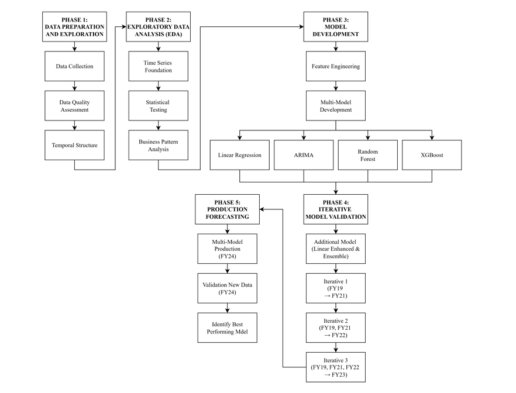

**Figure 1: Flowchart of the analysis and forecasting workflow**

The work was carried out in five phases.

1. **Data preparation.** The raw CSV was loaded with an encoding fallback, filtered to accepted claims, cleaned, and mapped to fiscal years.
2. **Exploratory data analysis.** Monthly series of `Total_RM`, claim count and mean claim cost were built. Trend, volatility, seasonality, outliers, vehicle model mix and failure severity were analysed.
3. **Feature engineering and model development.** 45 features were engineered in five groups: temporal dummies (fiscal month, fiscal year, trend index), lag features (Lag-1 to Lag-3), rolling features (3-month and 6-month means), vehicle model proportions, and growth rates. Three feature sets were defined: minimal (13), standard (25) and full (45), matched to model complexity.
4. **Iterative walk-forward validation.** Each iteration trains only on completed fiscal years and predicts the next unseen year. Standard k-fold cross-validation was avoided because it lets the model train on future data.
5. **Production forecast and validation.** All models were trained on FY2019 to FY2023, forecast the 12 months of FY2024, and were compared with actual FY2024 data.

### Models

| Model | Feature set | Key design choice |
|---|---|---|
| Linear Regression | Minimal (13 features) | OLS with SelectKBest feature selection; Ridge variant tested |
| ARIMA | Univariate | Grid search over (p,d,q); SARIMA also tested; AIC-selected |
| Random Forest | Standard (25 features) | Expanding-window cross-validation; conservative depth and split constraints |
| XGBoost | Standard (15 features) | Strong L1 and L2 regularisation; gain-based feature importance |

A fifth model, Linear Enhanced, was kept for audit purposes only and is not a production model.

### Validation Iterations

| Iteration | Training data | Test year | Purpose |
|---|---|---|---|
| 1 | FY2019 | FY2021 | Minimum-data performance baseline |
| 2 | FY2019 + FY2021 | FY2022 | Effect of one additional training year |
| 3 | FY2019 + FY2021 + FY2022 | FY2023 | Convergence and generalisation test |

## Exploratory Data Analysis

### Cost Trend and Volatility

Figure 2 shows the monthly claim volume, total cost and unit cost, and the gap left by the excluded FY2020 period.

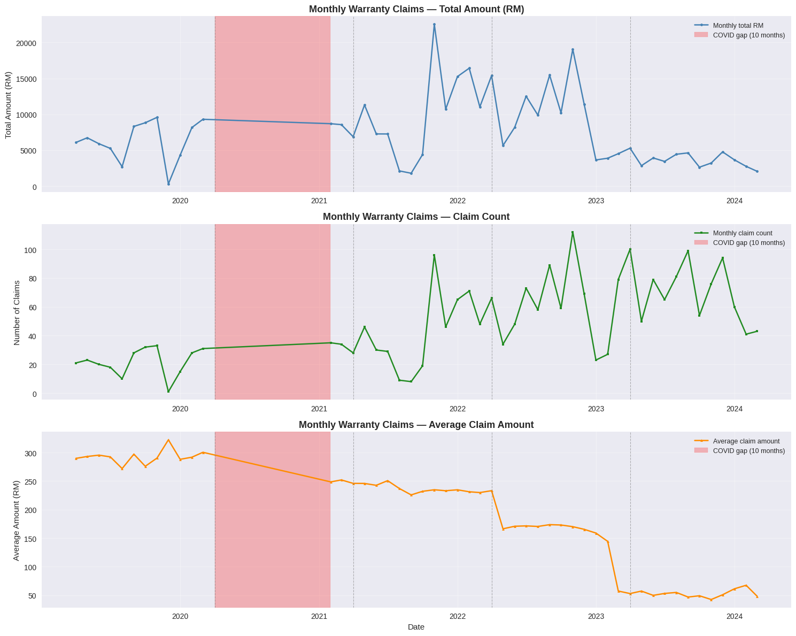

**Figure 2: Time series of warranty claim volume, total cost and unit cost**

Costs peaked in FY2021 and FY2022 and declined sharply from FY2023 onwards. A linear trend of about -RM 56 per month was found, but it is not statistically significant (p = 0.27) because of high noise. This is the structural change that all models had to handle.

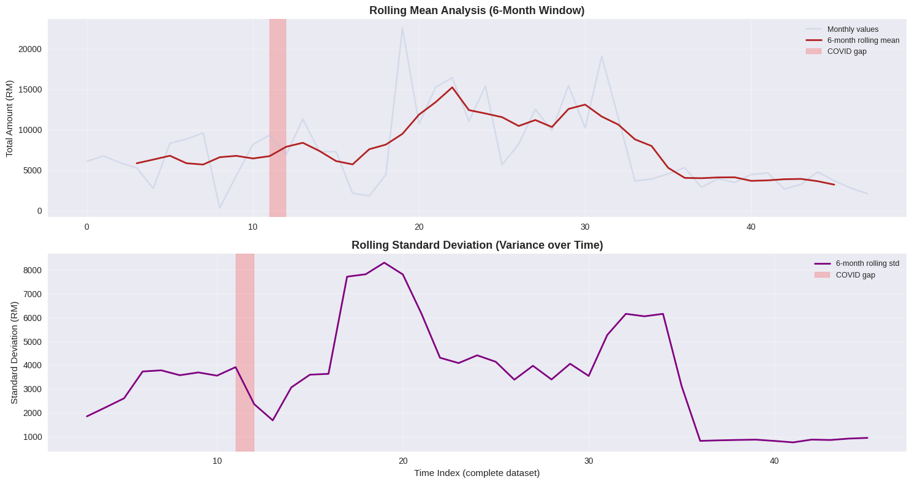

**Figure 3: 6-month rolling mean and standard deviation of claim amounts**

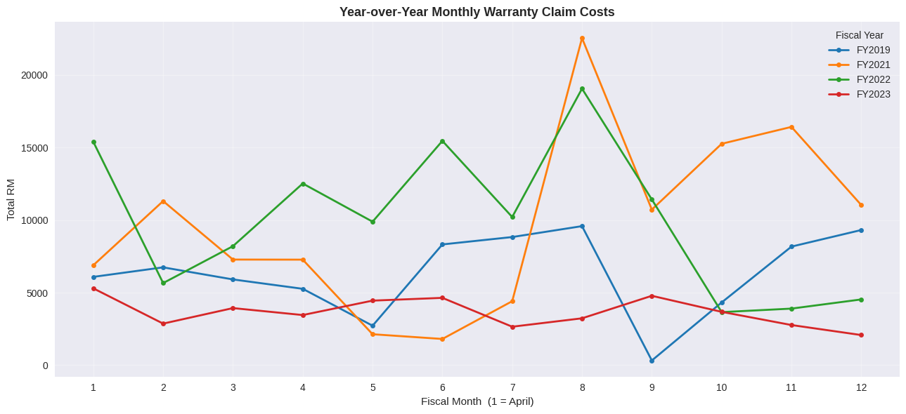

**Figure 4: Year-over-year monthly cost by fiscal year (FY2019 to FY2023)**

FY2022 was the peak cost year (mean RM 9,993 per month), and FY2023 dropped 63% to RM 3,652. The monthly pattern also changed between years, not just the level, which made the history a weak guide for FY2024.

### Seasonality and Distribution

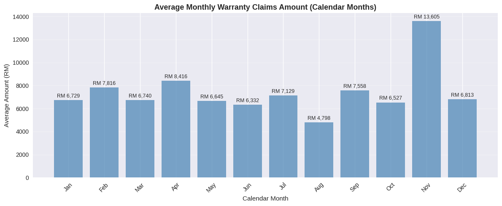

**Figure 5: Average monthly warranty claim amount by calendar month**

The seasonality strength ratio is 1.186, which is strong. November peaks at an average of RM 13,605, nearly three times the lowest month, August (RM 4,798). This November average is heavily influenced by a single outlier month, November 2021 (RM 22,545), so it should be read with caution.

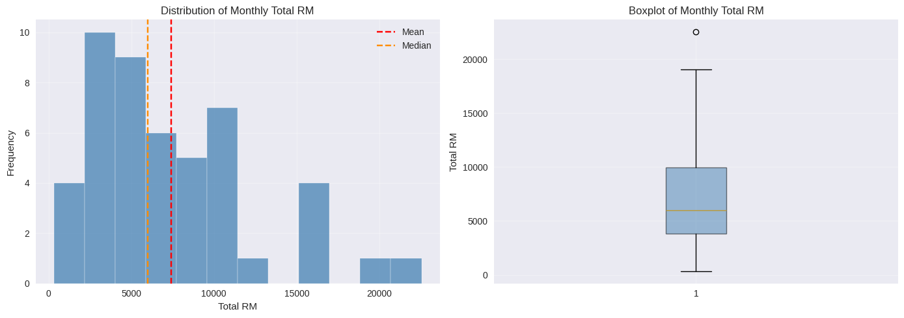

**Figure 6: Distribution of monthly total warranty expenses (RM)**

### Cost Drivers

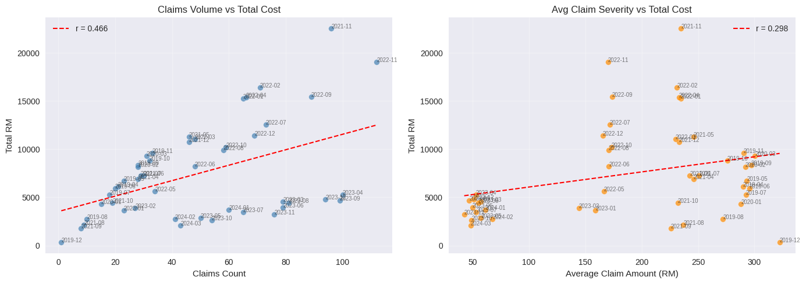

**Figure 7: Total warranty cost against claim volume and average claim severity**

Monthly claim count and total cost have a Pearson correlation of 0.47, with a slope of about RM 80 per additional claim per month. Volume, not per-claim severity, is the primary cost driver.

### Vehicle Mix, Parts and Failure Severity

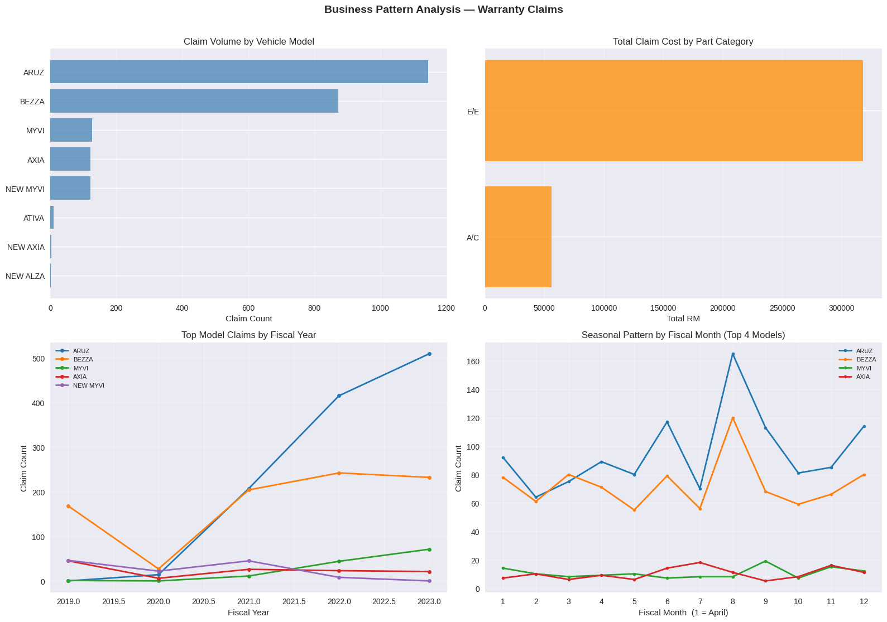

**Figure 8: Vehicle model breakdown, part categories, fiscal progression and seasonality**

ARUZ claims grew from 0 in FY2019 to 509 in FY2023, while NEW MYVI was phased out. A chi-square test (p = 0.000) confirms the shift in vehicle mix is statistically significant.

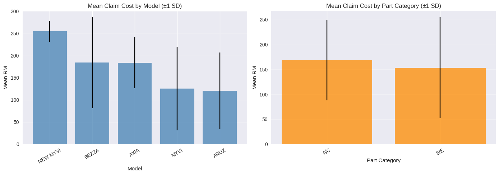

**Figure 9: Average claim amount by vehicle model and part category**

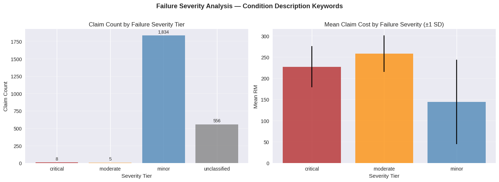

**Figure 10: Claim count and mean cost by failure severity tier**

Severity tiers were assigned using domain-specific keyword rules on the condition description.

## Feature Engineering and Model Development

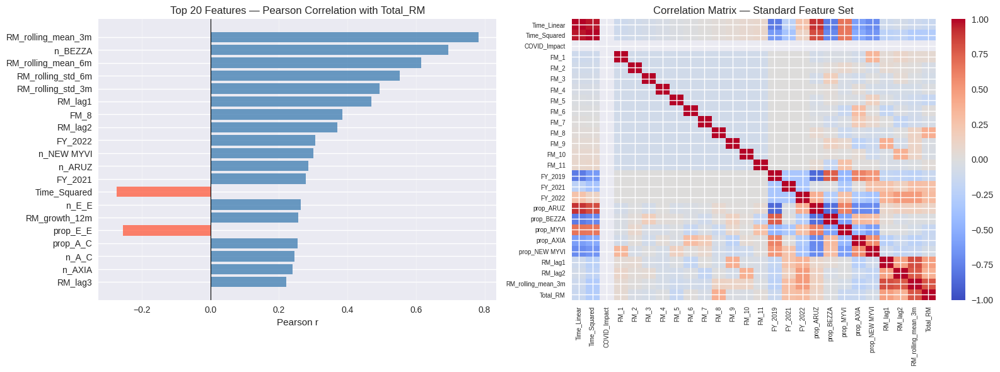

**Figure 11: Top 20 predictors of total warranty amount and full feature correlation matrix**

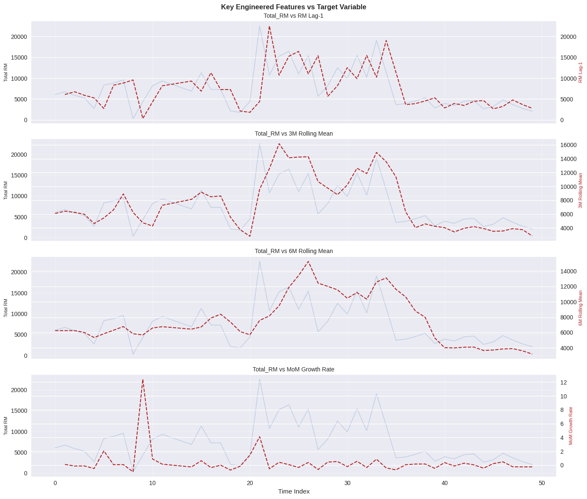

**Figure 12: Lag-1, rolling means and month-on-month growth against `Total_RM`**

Lag and rolling features follow the target closely, which supports the use of recent history as a predictor. This is confirmed by the model importance scores below.

### Linear Regression

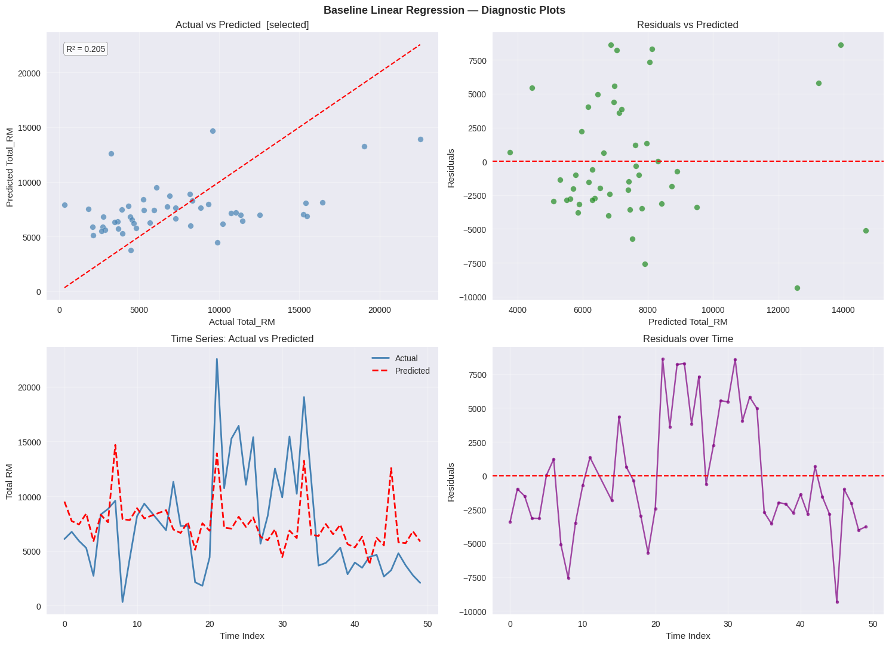

**Figure 13: Baseline Linear Regression performance and diagnostic plots (R² = 0.205)**

### ARIMA

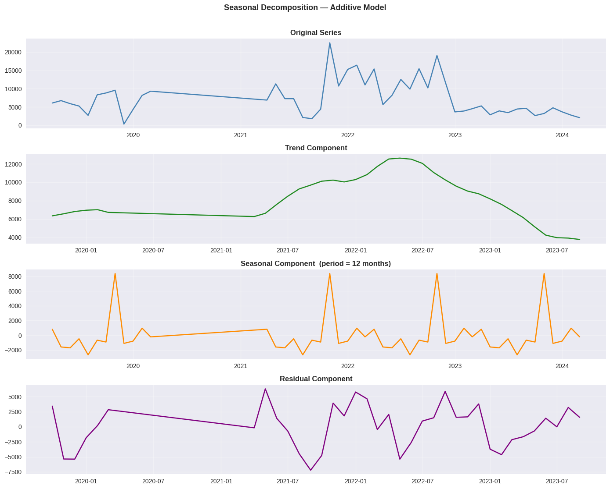

**Figure 14: Decomposition into observed series, trend, 12-month seasonality and residuals**

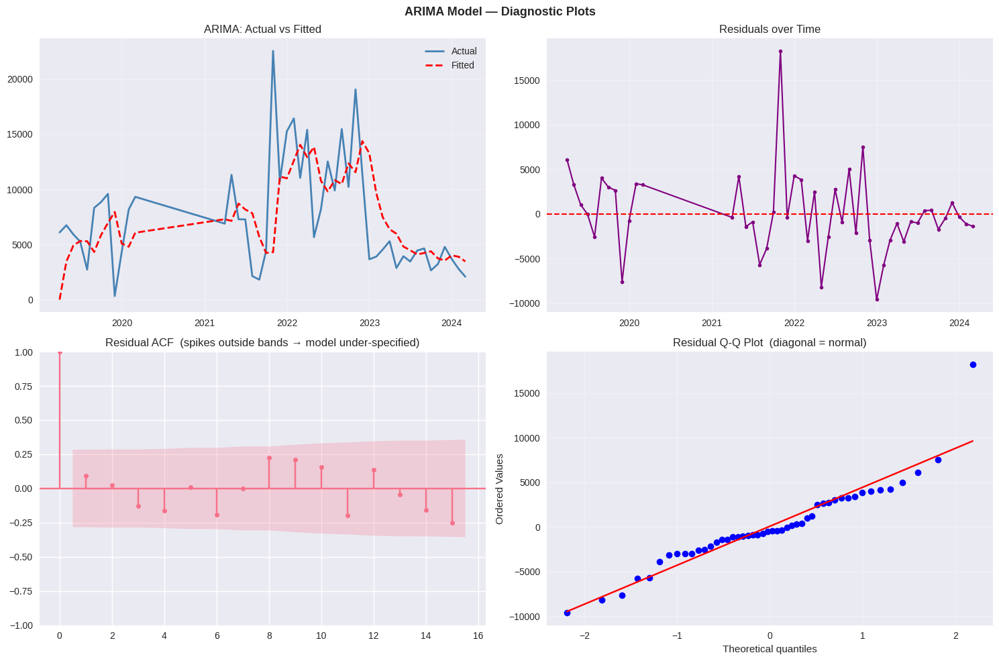

**Figure 15: ARIMA in-sample fit, residual autocorrelation function (ACF) and normality check**

### Random Forest and XGBoost

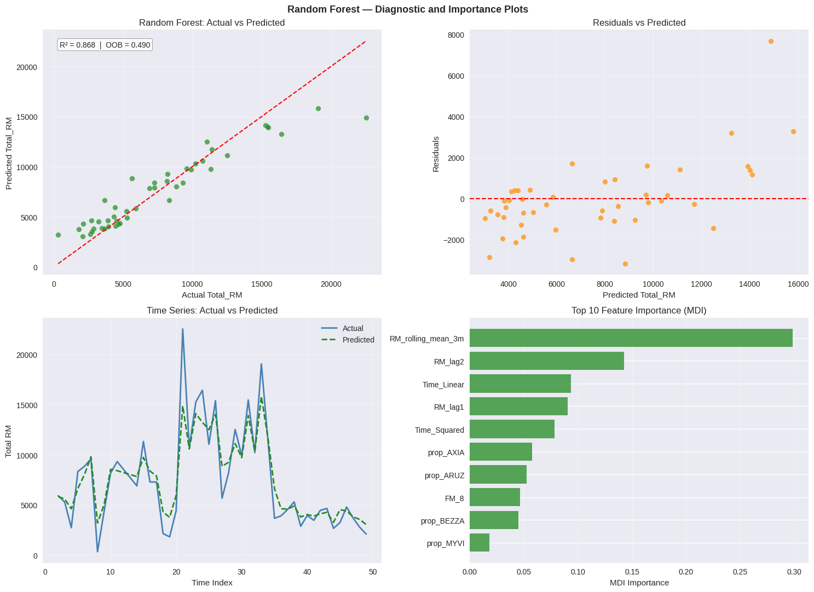

**Figure 16: Random Forest actual vs predicted fit, residuals, time-series alignment and MDI feature importance**

Random Forest top features were `RM_rolling_mean_3m` (29.9%), `RM_lag2` (14.2%) and `Time_Linear` (9.4%). Rolling and lag features together account for 53% of importance.

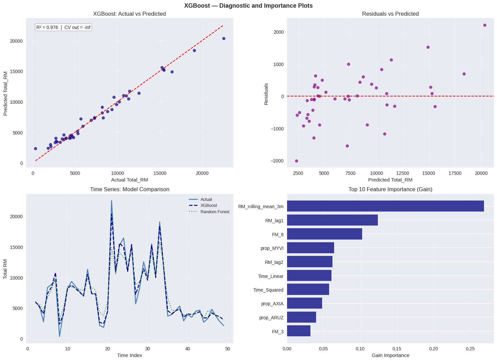

**Figure 17: XGBoost accuracy, residuals and multi-model time-series comparison**

XGBoost top features were `RM_rolling_mean_3m` (26.9%), `RM_lag1` (12.4%) and `FM_8` (10.3%), which agrees with Random Forest on the top feature. The in-sample fit was high (XGBoost R² = 0.976, Random Forest R² = 0.868), but cross-validation scores were strongly negative (XGBoost -inf, Random Forest -9.62). The models memorised the small training set instead of learning general patterns.

## Results and Key Findings

### Walk-Forward Validation

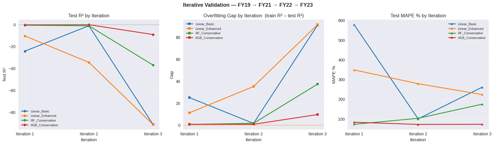

**Figure 18: Out-of-sample performance across the three validation iterations (FY2019 to FY2023)**

All four models had negative out-of-sample R² in every iteration. XGBoost (conservative settings) performed best on average (R² = -3.09). Performance got worse as more training years were added, which signals that FY2023 was structurally different from the earlier years.

### FY2024 Forecasts

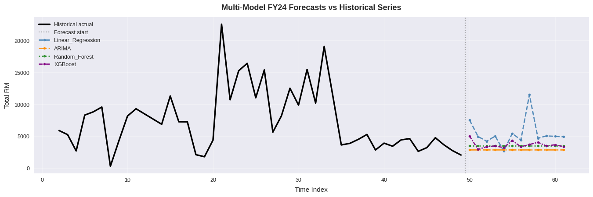

**Figure 19: Multi-model FY2024 forecasts against the historical warranty claims series**

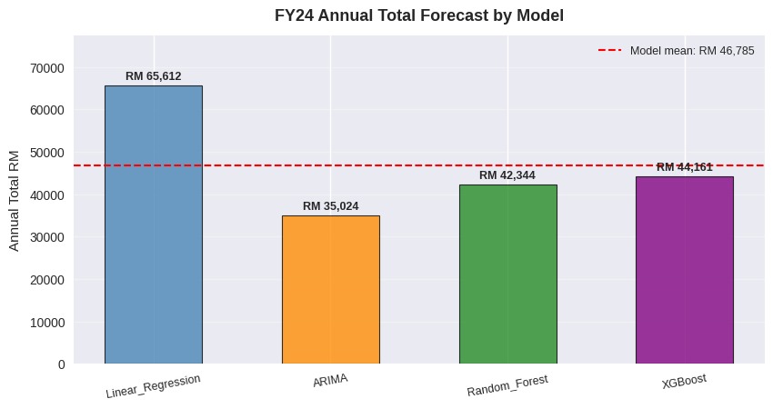

**Figure 20: FY2024 annual total forecast by model against the aggregate model mean**

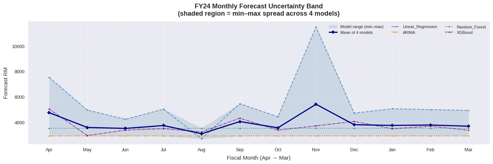

**Figure 21: FY2024 monthly forecast range (minimum to maximum) and ensemble mean across the four models**

### FY2024 Validation Against Actual Data

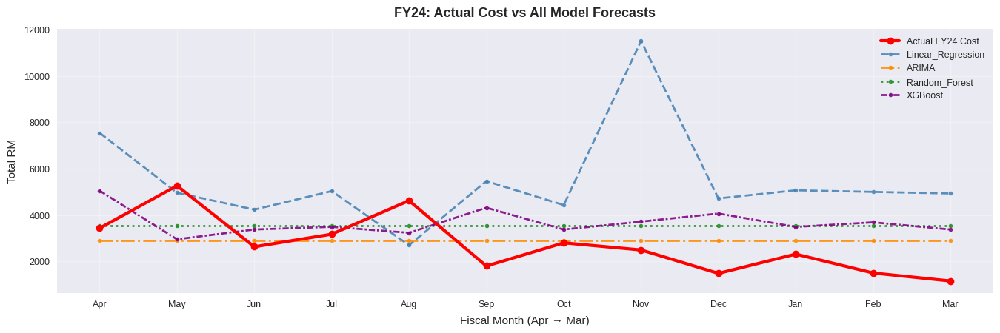

**Figure 22: FY2024 actual warranty cost against all model forecasts**

ARIMA and Random Forest produce flat monthly forecasts, and Linear Regression spikes in November. Actual costs declined throughout the year and fell below all model predictions by year-end.

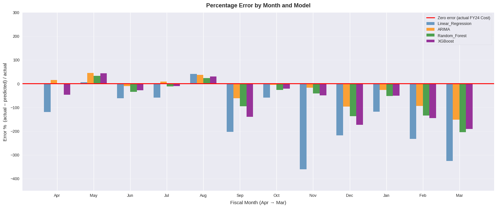

**Figure 23: Monthly relative percentage deviation from actual FY2024 costs**

Linear Regression's November error is the largest (+361%). ARIMA shows the smallest and most consistent errors.

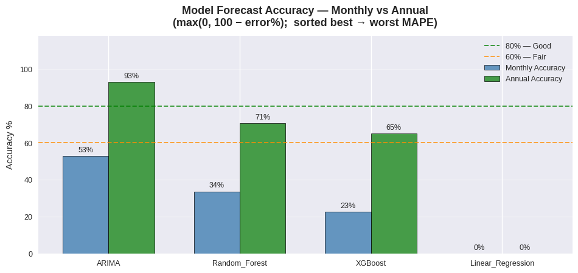

**Figure 24: Out-of-sample accuracy at monthly and annual granularity**

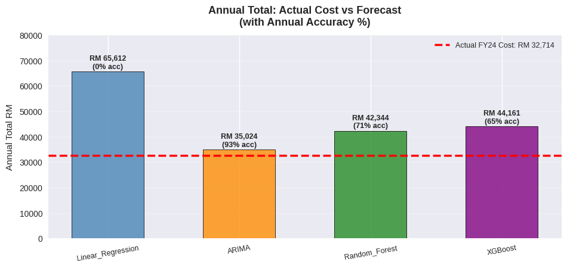

**Figure 25: FY2024 annual forecast against actual cost (RM 32,714) and annual accuracy by model**

### Final Scorecard

| Rank | Model | Annual forecast | Actual | Error | Annual accuracy | Grade |
|---|---|---|---|---|---|---|
| 1 | ARIMA | RM 35,024 | RM 32,714 | -7.1% | 92.9% | Good |
| 2 | Random Forest | RM 42,344 | RM 32,714 | -29.4% | 70.6% | Fair |
| 3 | XGBoost | RM 44,161 | RM 32,714 | -35.0% | 65.0% | Fair |
| 4 | Linear Regression | RM 65,612 | RM 32,714 | -100.6% | 0.0% | Poor |

### Key Findings

- ARIMA achieved 92.9% annual accuracy and is suitable as the primary annual budget planning tool.
- The classical ARIMA model outperformed Random Forest and XGBoost. The likely reasons are the small dataset (46 training observations), the structural cost change between FY2022 and FY2023, and the frozen lag features in tree model forecasting. Simpler models generalise better when data is short and volatile.
- Warranty costs declined structurally, from a FY2022 peak of about RM 120,000 annualised to RM 32,714 in FY2024 (-73%). Future provisions should be anchored to the RM 30,000 to RM 40,000 range.
- No model predicted monthly cost direction reliably. Directional accuracy was 0% for both ARIMA and Random Forest. The forecasts are best used for annual planning, not monthly operations.
- Claim volume, not severity, is the main cost driver. Reducing failure frequency would have more financial impact than reducing repair cost per claim.

## Project Structure

```text
warranty-claim-cost-forecasting/
├── README.md
├── requirements.txt
├── .gitignore
├── warranty_cost_forecasting.ipynb
├── data/
│   └── README.md
└── images/
```

The `data/` folder holds the confidential CSV files locally. They are excluded by `.gitignore`.

## Installation and Setup

Requirements: Python 3.10 or later.

```bash
git clone https://github.com/<your-username>/warranty-claim-cost-forecasting.git
cd warranty-claim-cost-forecasting
python -m venv .venv
source .venv/Scripts/activate   # Windows (Git Bash). On macOS or Linux: source .venv/bin/activate
pip install -r requirements.txt
```

## How to Run

1. Place the two data files in the `data/` folder:
   - `fy19-fy23_warranty_claims.csv` (training data, FY2019 to FY2023)
   - `fy24_warranty_claims.csv` (validation data, FY2024)
2. Open `warranty_cost_forecasting.ipynb` in Jupyter or VS Code and select the Python environment that has the requirements installed.
3. Run all cells in order. The notebook reads the files from `data/` and finds the folder automatically.

The data is confidential, so the notebook cannot be run without access to the original files.

## Limitations and Future Improvements

### Limitations

- Small dataset: 46 training observations for monthly forecasting.
- A structural change in cost between FY2022 and FY2023 limits how well history predicts FY2024.
- FY2020 was excluded because of the MCO lockdown.
- Validation uses a single 12-month test year.
- No external variables were used, and only alternator claims on P Model vehicles were covered.

### Future Improvements

1. Include more historical data (before FY2019) for a longer, more stable training base.
2. Update lag features sequentially during forecasting to improve tree model monthly predictions.
3. Add external regressors such as vehicle registration volumes (JPJ), the holiday calendar and service centre capacity.
4. Retrain ARIMA every year with the latest completed fiscal year.
5. Add prediction intervals to give statistically defensible budget ranges.